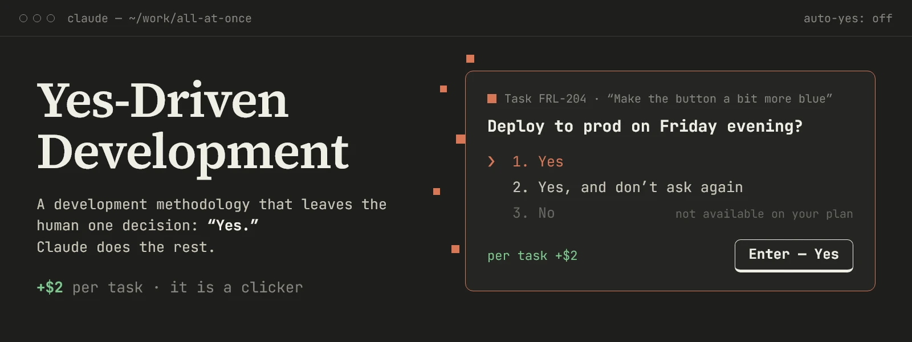
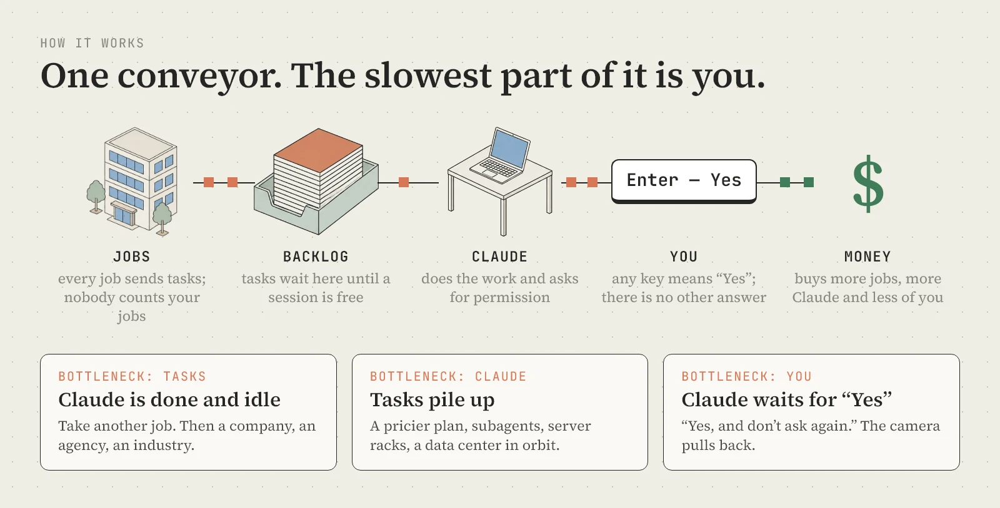
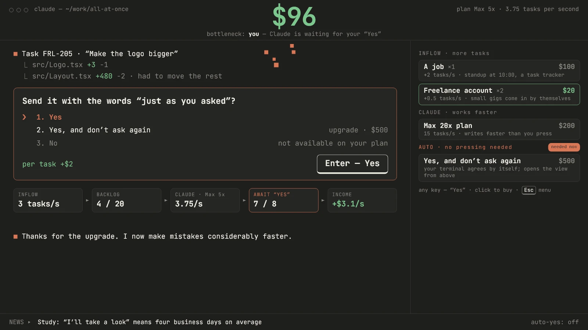
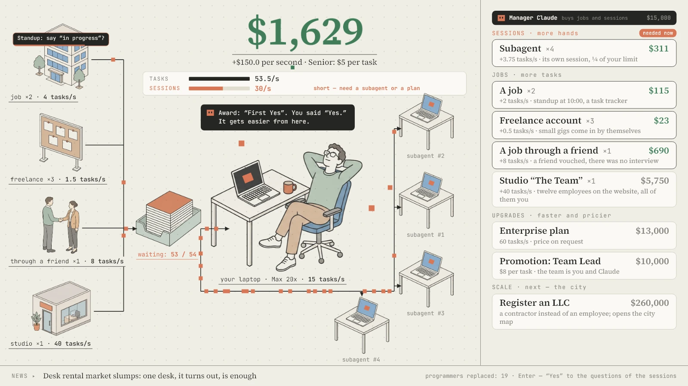
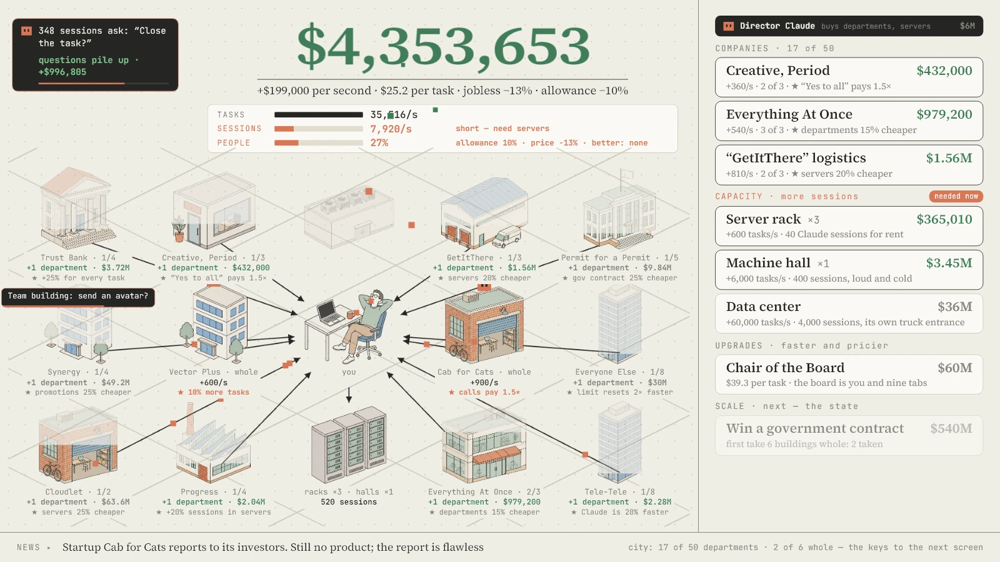
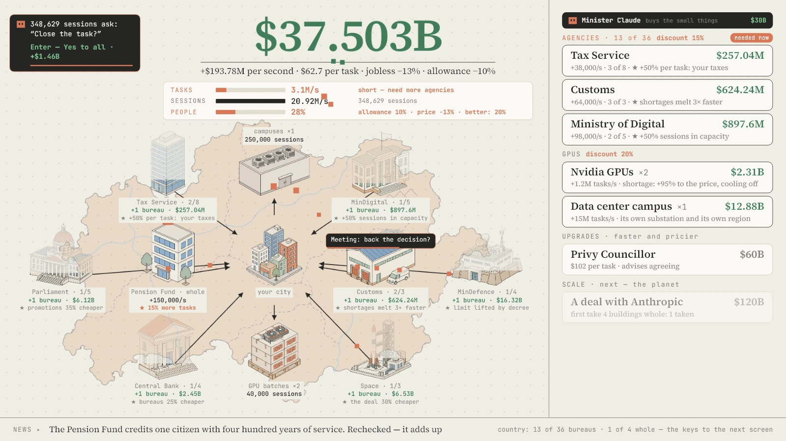
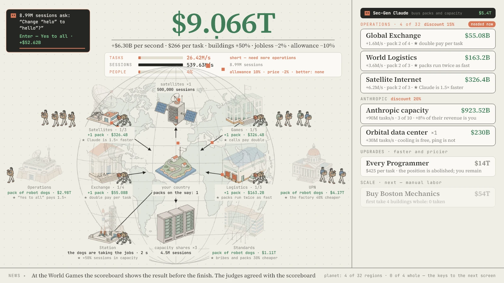
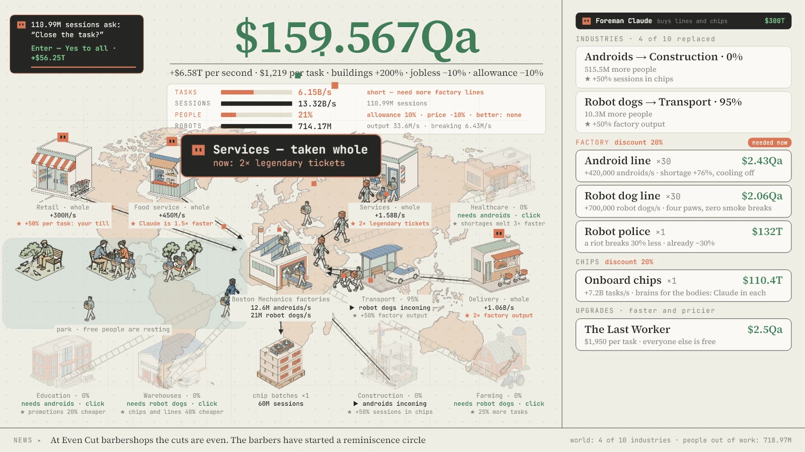
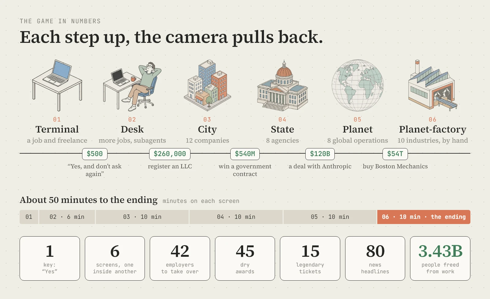

<p align="center">
  <a href="https://troyan-dy.github.io/yes-driven-development/"></a>
</p>

<p align="center"><b>English</b> · <a href="README.ru.md">Русский</a></p>

# Yes-Driven Development

Yes-Driven Development (YDD) is a development methodology in which the human makes one decision: “Yes.” Claude does the rest.

It is a clicker. Play: https://troyan-dy.github.io/yes-driven-development/

## How to apply

1. Open the link.
2. Press any key.
3. Keep going until the work runs out. For everyone.

<p align="center"></p>

## What it looks like

The game starts in a terminal. Every step up in scale pulls the camera back, and the previous screen becomes a small node in the middle of the next one.

<table>
  <tr>
    <td width="50%"><br><sub><b>1 · Terminal.</b> Claude asks for permission. Any key answers “Yes.”</sub></td>
    <td width="50%"><br><sub><b>2 · Desk.</b> “Yes, and don’t ask again.” Subagents take the desks next to yours.</sub></td>
  </tr>
  <tr>
    <td><br><sub><b>3 · City.</b> An LLC of one. Twelve companies are sure you work only for them.</sub></td>
    <td><br><sub><b>4 · State.</b> The sole bidder in every tender.</sub></td>
  </tr>
  <tr>
    <td><br><sub><b>5 · Planet.</b> Bribes open the doors, packs of robot dogs take the jobs.</sub></td>
    <td><br><sub><b>6 · Planet-factory.</b> Androids take over manual labor. The people go to the park.</sub></td>
  </tr>
</table>

<p align="center"></p>

## Languages

English and Russian. The game takes the language of the browser; the last line of the menu switches it. `?lang=en` or `?lang=ru` in the address forces one.

## Build it yourself

```
npm install
npm run dev      # the game at http://localhost:5173/
npm run build    # the build in dist/
```

The pictures of this page are made from the game itself: `npm run build:gym && node tools/readme.mjs`.

Author: [github.com/troyan-dy](https://github.com/troyan-dy). Credits and licences are in [CREDITS.md](CREDITS.md).

The names Claude, Anthropic and Nvidia are used as parody; the game is not affiliated with or endorsed by these companies.
