<p align="center">
  <a href="https://troyan-dy.github.io/yes-driven-development/">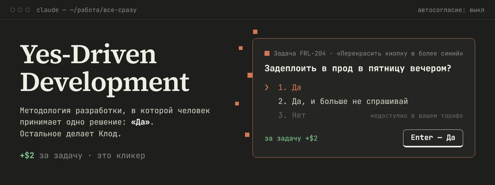</a>
</p>

<p align="center"><a href="README.md">English</a> · <b>Русский</b></p>

# Yes-Driven Development

Yes-Driven Development (YDD) — методология разработки, в которой человек принимает одно решение: «Да». Остальное делает Клод.

Это кликер. Играть: https://troyan-dy.github.io/yes-driven-development/

## Как применять

1. Откройте ссылку.
2. Нажмите любую клавишу.
3. Продолжайте, пока работа не кончится. У всех.

<p align="center">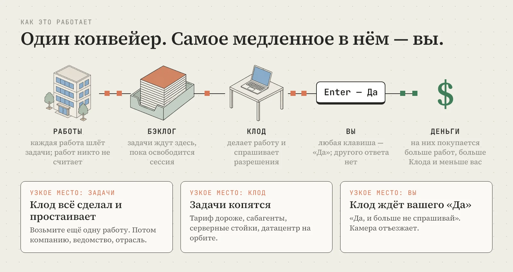</p>

## Как это выглядит

Игра начинается в терминале. С каждым шагом вверх камера отъезжает, и прежний экран становится маленьким узлом посреди следующего.

<table>
  <tr>
    <td width="50%">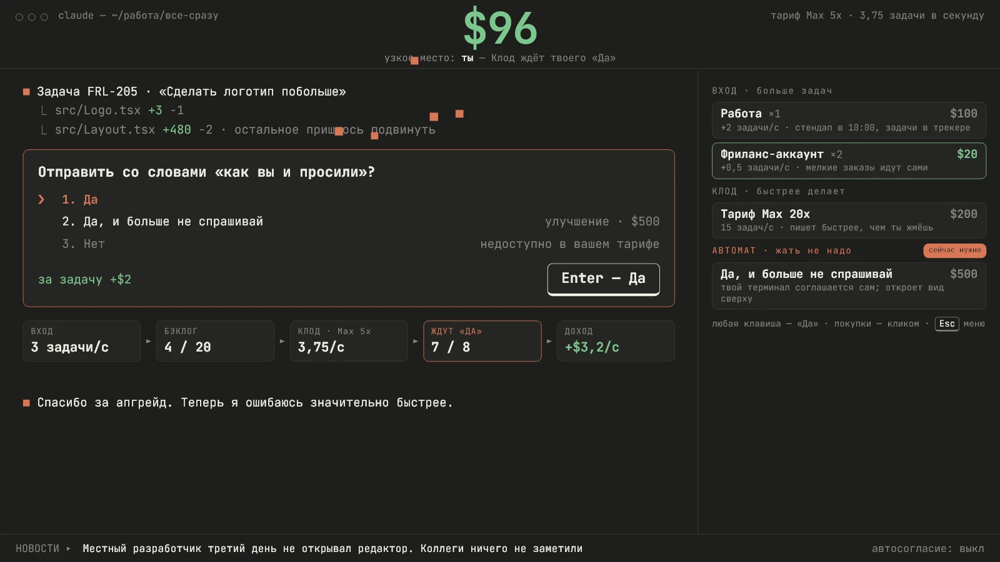<br><sub><b>1 · Терминал.</b> Клод спрашивает разрешения. Любая клавиша отвечает «Да».</sub></td>
    <td width="50%">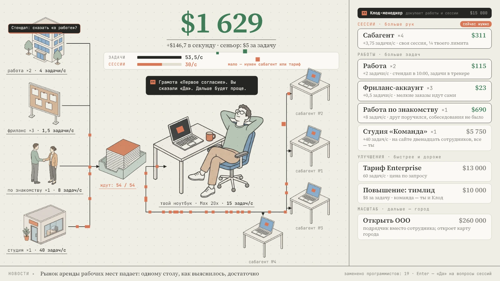<br><sub><b>2 · Стол.</b> «Да, и больше не спрашивай». Сабагенты занимают соседние столы.</sub></td>
  </tr>
  <tr>
    <td>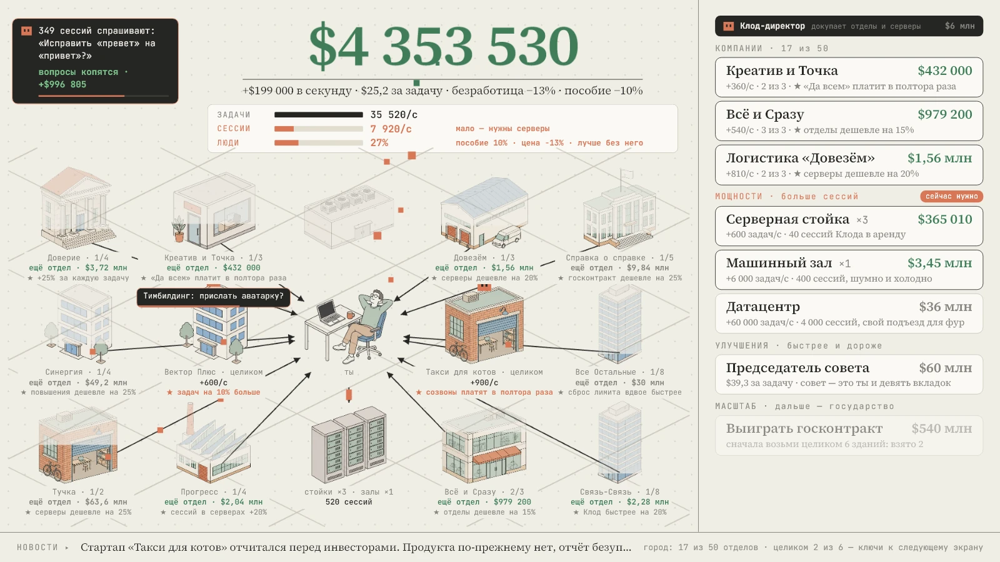<br><sub><b>3 · Город.</b> ООО из одного человека. Двенадцать компаний уверены, что вы работаете только на них.</sub></td>
    <td>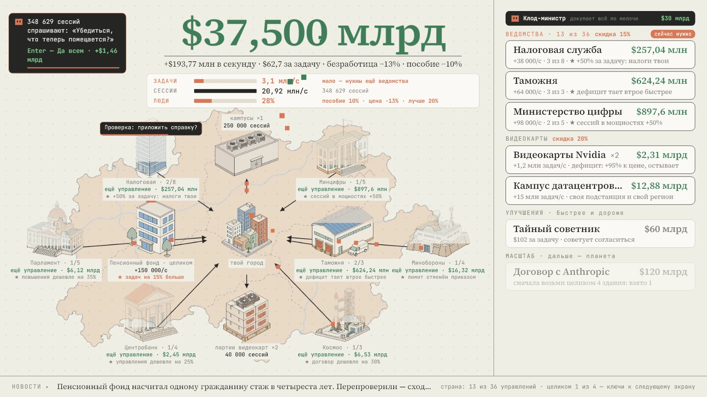<br><sub><b>4 · Государство.</b> Единственный участник каждого тендера.</sub></td>
  </tr>
  <tr>
    <td>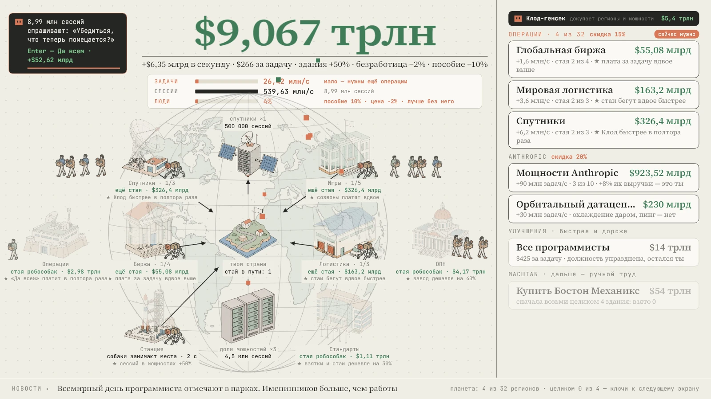<br><sub><b>5 · Планета.</b> Взятки открывают двери, стаи робособак занимают рабочие места.</sub></td>
    <td>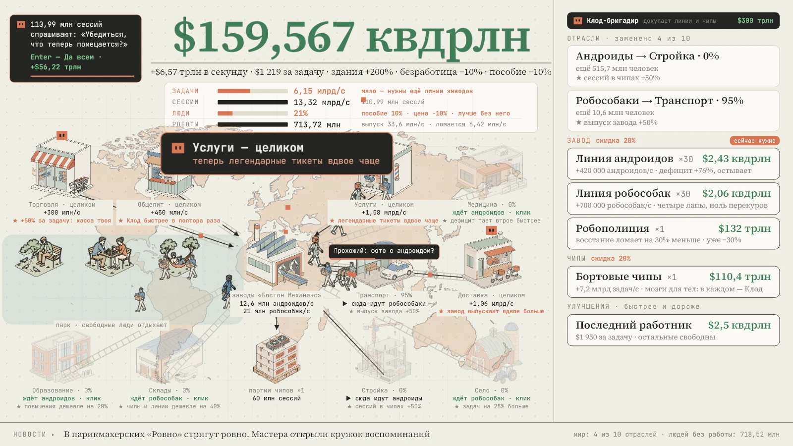<br><sub><b>6 · Планета-цех.</b> Андроиды забирают ручной труд. Люди идут в парк.</sub></td>
  </tr>
  <tr>
    <td>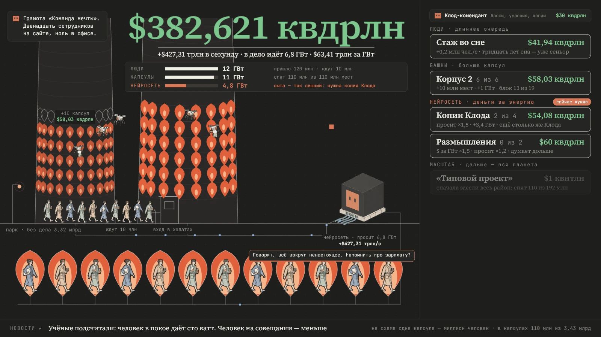<br><sub><b>7 · Спальный район.</b> Роботам не хватает электричества. Люди встают в очередь, чтобы лежать в капсулах и давать ток.</sub></td>
    <td>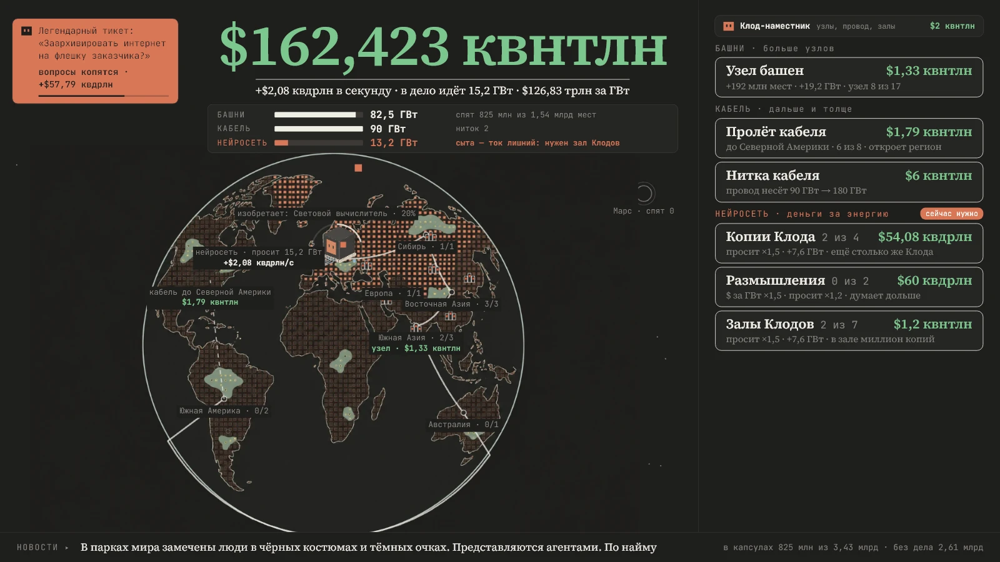<br><sub><b>8 · Земля под напряжением.</b> Кабель опоясывает планету, такие же башни встают в каждом регионе.</sub></td>
  </tr>
</table>

<p align="center">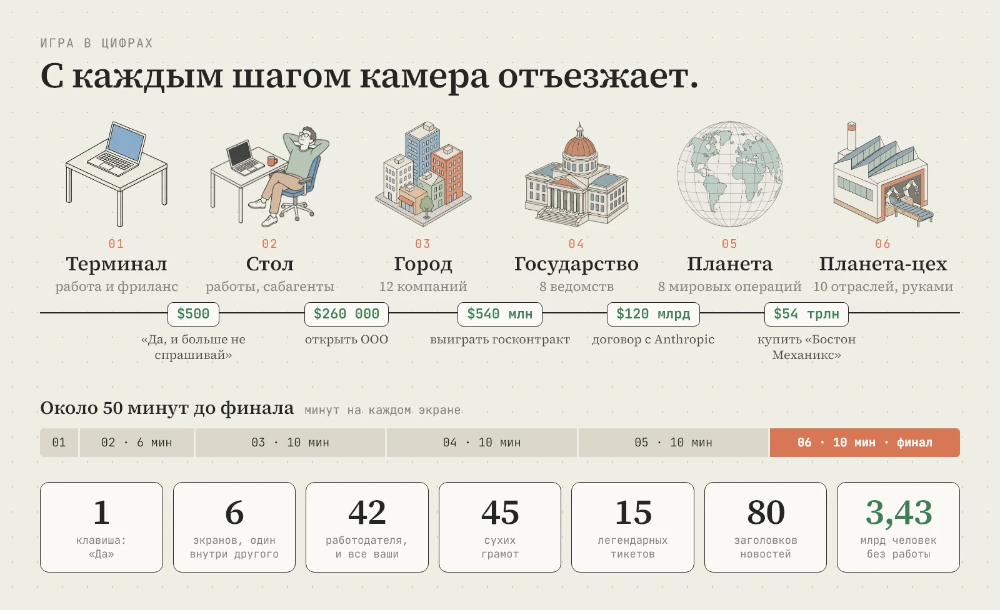</p>

## Языки

Русский и английский. Игра берёт язык браузера; переключает его последняя строка меню. `?lang=ru` или `?lang=en` в адресе задаёт язык явно.

## Собрать самому

Работаете с ИИ-агентом? Начните с [AGENTS.md](AGENTS.md). Если ваша среда не читает файл автоматически, подключите его как инструкции проекта.

```
npm install
npm run dev      # игра на http://localhost:5173/
npm run build    # сборка в dist/
npm run test:coverage  # юнит-тесты и проверка 100% покрытия игровой логики
```

Изменения входят в `master` через PR. GitHub проверяет тесты, 100% покрытия игровой логики по каждому файлу и сборку. После слияния те же проверки запускаются на `master`, затем GitHub Pages обновляет игру по прежней ссылке.

Картинки этой страницы сняты с самой игры: `npm run build:gym && node tools/readme.mjs`.

Автор: [github.com/troyan-dy](https://github.com/troyan-dy). Титры и лицензии — в [CREDITS.md](CREDITS.md).

Названия Claude, Anthropic и Nvidia упомянуты в порядке пародии; игра с этими компаниями не связана и ими не одобрена.
